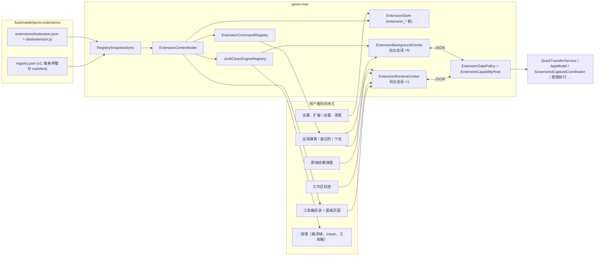
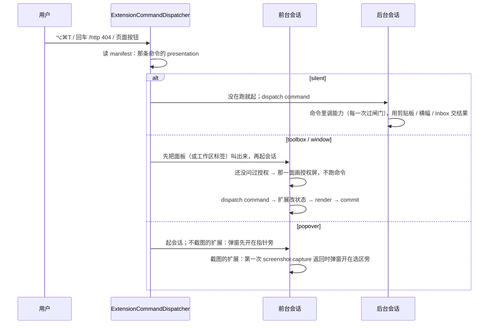
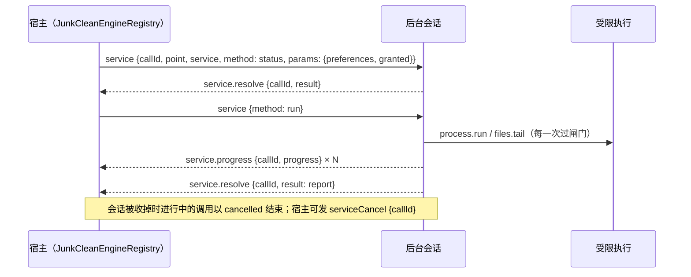
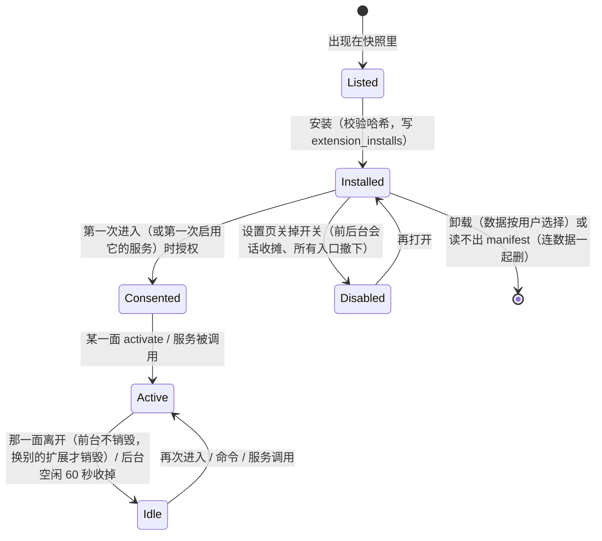

# 框架层级设计

## Overview

三个东西、两条边界：

- **仓库**（本仓库）：扩展的源码与产物、`registry.json`、schema、SDK。它是扩展商店的**真源**，宿主只读不写。
- **宿主**（`jarvis-mac`）：把仓库快照拉到本机、罗列、安装、跑扩展的 JS、把节点树画成 SwiftUI、
  把每一次能力调用拦在闸门上、把扩展的入口合进工具箱 / 工作区 / `/` 指令 / 设置 / 内置能力的扩展点。
- **扩展**（一个或两个 `JSContext`）：只认识 `jarvis` 这一个全局对象与它自己的状态。

边界一在**仓库与宿主之间**：宿主认的只有 `registry.json` 与 `extension.json` 两份 schema 化的事实
（v2），产物按 SHA-256 校验。边界二在**宿主与扩展之间**：两边只交换 JSON 字符串（线缆协议 2），
扩展没有 DOM、没有文件系统、没有网络、没有进程，每一次调用都过能力闸门。

## Architecture & Logic

### 分层落位（对齐 `jarvis-mac` 的项目边界）

| 层 | 类型 | 职责 | 边界 |
| --- | --- | --- | --- |
| `Domain` | `ExtensionManifest`（+ 校验）、`ExtensionRegistry`、`ExtensionCapabilityMap`、`ExtensionGatePolicy`、`ExtensionCatalogPolicy`、`ExtensionCommandCatalog`、`ExtensionProcessPolicy`、`ExtensionJunkCleanContract`、`ExtensionProjectEngineContract`、`GitHostingGraphQLPolicy`、`ExtensionSurfacePolicy`、`ExtensionBridgeMessage`、`ExtensionCompatibilityPolicy`、`ExtensionStorePolicy`、`ExtensionUINode`、`MemoSlashMenu`、`JunkCleanEngineDescriptor` | 纯值与纯函数：manifest 解析与跨字段校验、能力映射与档位、闸门六步、目录合并、指令表与冲突、受限执行的放行判定、服务载荷解码、三面的优先级 | **不 import SwiftUI、不碰 JavaScriptCore**，文件系统的问题由调用方注入 |
| `Infrastructure` | `RegistrySnapshotSync`、`ExtensionStore`、`ExtensionInstallDirectory`、`ExtensionBundleVerifier`、`ExtensionJSContext`、`ExtensionNetworkClient`、`ExtensionProcessRunner`、`ExtensionFileReader`、`ExtensionKeychainSecretStore` | 拉快照、解包、校验哈希、建 `JSContext`、SQLite 读写、HTTPS 白名单请求、起外部进程、读声明过的文件、钥匙串 | `OpaquePointer` 与 `JSContext` 不越出本层 |
| `App` | `ExtensionCenterModel`、`ExtensionSessionModel`、`ExtensionRuntimeCenter`、`ExtensionBackgroundCenter`、`ExtensionCommandDispatcher`、`ExtensionCapabilityHost`、`ExtensionHotKeyCenter`、`ExtensionCommandRegistry`、`JunkCleanEngineRegistry`、`ProjectEngineRegistry`、`ExtensionPreferencesModel`、`ExtensionGrantsModel`、`ExtensionWindowPresenter` | `@MainActor` 状态；把闸门后的调用转给既有模型；按落点分派命令；按扩展点调服务 | 只调既有模型的公开方法，不复制它们的逻辑 |
| `UI` | `FloatingExtensionStoreView`、`ExtensionStoreDetailView`、`FloatingExtensionHostView`（工具箱与窗口两面共用）、`ExtensionWorkspacePage`、`ExtensionPopoverWindow`、`ExtensionRendererView`、`ExtensionConsentView`、`ExtensionSettingsSection`、`ExtensionPreferenceControls`、`JunkCleanSettingsSection` | 画 | 不承载协议解析；节点视图只读 `JarvisDesign` |

## Concepts

### 快照：宿主怎么"访问 git 仓库"

宿主**不调用 `git`**：`/usr/bin/git` 在没装 Command Line Tools 的机器上会弹一扇系统对话框，
一个常驻的菜单栏应用不能在用户点开扩展商店的那一下弹出这种东西。它也不走 SSH 与 `api.github.com`（匿名限流 60 次/小时）。

| 项 | 值 | 为什么 |
| --- | --- | --- |
| 来源 | `https://codeload.github.com/fusionseek/jarvis-extensions/zip/refs/heads/main` | 一次请求拿到整份仓库 |
| 落点 | `~/Library/Caches/<渠道目录>/extensions/registry/` | Caches 是可重建数据的语义位置，系统可清、清了再拉 |
| 条件请求 | `If-None-Match` 带上次的 ETag，原样回传 | 没变就 304，一个字节都不下 |
| 节奏 | 打开扩展商店时距上次同步 ≥ 30 分钟才拉；页面上有「刷新」 | 先画缓存那一份，再在后台换新 |
| 只解三类 | `registry.json`、`extensions/<id>/extension.json`、`extensions/<id>/dist/<file>.js` | `docs/`、`sdk/`、`scripts/` 对宿主没有意义 |
| 上限 | 归档 ≤ 64 MB，解出 ≤ 256 MB | 不是安全边界，是不让一个失控的仓库吃掉磁盘 |

**前提：仓库必须是 public。** 私有仓库匿名拉不到 zipball，而扩展商店没有登录这一步。

### 索引 v2：每一条带整份 manifest

`registry.json` 的每一条是 `{ manifest, path, bundle, updatedAt }`——**整份 manifest 原样带着**，不是投影。
商店要在安装之前就把它会跑的可执行文件、会读的文件、会执行的脚本念给用户听，投影出来的摘要做不到这一点。

读取分两层，后果不同：

| 层 | 读不出来时 |
| --- | --- |
| 索引本身（版本、`source`、条目的 id / 版本 / 路径 / 哈希） | **整份快照作废**，商店画上一份能用的，状态条写「最新快照无法解析」——不猜、不部分采用 |
| 某一条的 manifest（用了这一版宿主还不认识的扩展点、落点） | **只有那一张卡**标成「这一版 Jarvis 读不懂它，更新之后再装」；名字、图标、说明照常画（宿主先按一份最小的头部读它） |

本机缓存的那一份快照读不出来时（例如索引刚换代），宿主把快照整个删掉、ETag 一起清——留着 ETag，下一次同步会 304 在
一份读不懂的快照上，商店永远空着。

### 安装、更新、卸载

安装 = 把快照里那个扩展的 `extension.json` 与 `main` 指向的 bundle 拷到
`~/Library/Application Support/<渠道目录>/extensions/<id>/<version>/`，并写一行 `extension_installs`。
拷之前先算 bundle 的 SHA-256 与索引里的 `bundle.sha256` 比对，**不等就一个字节都不留**。安装**不弹授权**。

更新 = 装新版本目录、切记录里的版本、删旧目录；正跑着的前台与后台会话先收摊——新旧两份代码不能在同一个上下文里各说各的。
授权按 `(extension_id, capability)` 存，跨版本保留；新版本新增的能力回到"还没问过"。

卸载 = 删目录、删安装 / 授权 / Inbox 卡的行；用户选「卸载并删除数据」时，偏好、存储与钥匙串里的机密一起删。

**读不出 manifest 的安装记录一律卸掉（连数据）。** 这是一条通用不变量：一条跑不起来、也画不出来的安装记录，
在工具箱、指令表、设置页里都只能是一行"坏了"。它顺带清掉 v1 的安装、被用户手动删了目录的安装与已退役的原生扩展记录。

### 运行时：前台会话与后台会话

| | 前台会话（`ExtensionRuntimeCenter`） | 后台会话（`ExtensionBackgroundCenter`） |
|---|---|---|
| 数量 | **全应用至多一个**（两个 JSContext 各占几 MB，用户一次只看一块界面） | 每个扩展至多一个，互不影响，也不影响前台 |
| 界面 | 三面：工具箱页面、原地结果弹窗、窗口标签；同一时刻只 activate 一面 | **没有**。`render` 永远不被调；`panel.*`、`ui.*`、`window.open` 以 `surface.unavailable` 拒绝 |
| 跑什么 | 页面、落点是 `toolbox` / `window` / `popover` 的命令 | 服务扩展点的调用、落点是 `silent` 的命令、菜单栏事件（SDK 2.9） |
| 何时起 | 用户打开那一面、或一条界面命令触发 | 第一次有调用时 |
| 何时收 | 换成别的扩展、停用、卸载、更新、退出应用 | 没有进行中的服务调用、没有在跑的常驻进程（SDK 2.9：退出事件与菜单栏点选要有人接）、且 60 秒内没有动静；停用 / 卸载 / 更新 / 退出立即收 |
| 授权 | 第一次进入时弹授权屏 | **不弹窗**（没有界面承载它）：没授权的能力照常 `permission.denied` |

两种会话装的是**同一份 bundle**，各自一个 `JSVirtualMachine`，互相看不见对方的内存；共享的只有宿主那边的存储与偏好。
静默命令放后台：它不需要界面，而在前台会话里跑会把用户正看着的另一个扩展页面收掉。

一面 activate 的优先级是**弹窗 > 窗口 > 工具箱页面**（`ExtensionSurfacePolicy`）。面板里挂着页面、
而它 activate 在窗口上时，面板那一页画「正开在窗口里 · 切到窗口」，不画一棵句柄已经不属于它的树。

| 项 | 值 | 为什么 |
| --- | --- | --- |
| 隔离 | 每个会话一个 `JSVirtualMachine` + `JSContext`，一条串行 `DispatchQueue` | 一个扩展死循环卡住的是它自己那条队列，不是主线程 |
| 全局环境 | ES2020 标准库 + `__jarvisHost` + `setTimeout` / `clearTimeout`；**没有** `fetch`、`XMLHttpRequest`、`require`、DOM、文件系统、`setInterval` | 能做的每一件事都必须经过闸门 |
| 定时器 | 单次 ≤ 30 s、同时挂起 ≤ 64 个，会话结束时全部取消 | 忘记 clear 的 interval 会在面板关掉之后继续醒着 |
| 慢调用 | 同步调用、提交、事件派发 ≥ 200 ms 记 warn、≥ 2 s 记 error | JavaScriptCore 没有公开的执行超时 API，能做的是看见它 |
| 输入框 | `field` / `editor` / `search` 的文本由宿主持有 | 打字不经 JS 往返，中文输入法的组合态不被异步回写打断 |

### 线缆（协议 2）

真源是 `jarvis-mac/contracts/schemas/extensions/bridge.v2.schema.json`，SDK 的 `src/bridge.ts` 是它的投影。

| 方向 | 消息 | 说明 |
| --- | --- | --- |
| SDK → 宿主 | `invoke(json)` | 异步能力调用；宿主回 `settle`。服务的回话也走这里：`service.resolve` / `service.progress` |
| SDK → 宿主 | `invokeSync(json) → json` | 纯函数工具（`text.*`：Base64、摘要、语言检测）与 `host.*`；不经事件循环 |
| SDK → 宿主 | `commit(json)` | 一棵序列化的节点树，带 `generation` 与 `surface`（`toolbox` / `popover` / `window`）；后台会话的提交一律丢弃 |
| SDK → 宿主 | `log(level, message, data)` | 进设置页那块扩展面板的日志（内存里，最近 200 条） |
| 宿主 → SDK | `dispatch(json)` | `activate` / `deactivate` / `settle` / `ui` / `command` / `service` / `serviceCancel` / `preferencesChanged` / `permissionsChanged` / `subscription` |

`protocol` 不是 2 的消息宿主一律拒绝，扩展页面写明原因。v1 的 `inboxAction` / `notificationActivated` 已删除。

### 静态面与动态面

manifest 声明的东西分两类，判据是**扩展的 JS 需不需要在跑**：

| 面 | 内容 | 谁持有 |
| --- | --- | --- |
| 静态面 | 工具箱那一行、窗口入口、`/` 指令表、全局快捷键、设置页面板与偏好控件、服务引擎在「清理」里的那一行、项目引擎在「Git」里的那一段 | **宿主**按 manifest 与库里的记录画与注册，扩展的 JS 可以完全没加载 |
| 动态面 | 页面（`render()` 出来的树）、命令的执行、服务调用、订阅回调 | 扩展的 `JSContext` |

因此 `/http` 在应用启动后就出现在 `/` 下拉里、`⌥⌘H` 就能按，服务引擎就出现在设置 · 清理 里——
都不需要扩展的 JS 在跑；真被用到的那一刻才起会话。

### 命令的生命周期

页面里的按钮触发命令走 `jarvis.commands.run(id, argument?)`，与快捷键同一条路（`trigger = "page"`），
落点不在当前这种会话时宿主替它转到对的那一种。一条命令只有一份实现。

### 服务调用的生命周期

### 能力闸门

每一次 `invoke` 先过 `ExtensionSessionModel.authorize`：

0. **后台会话里的界面类调用**（`panel.*`、`window.open`、`ui.dismissPopover`）直接 `surface.unavailable`——在六步之前；
1. `namespace.method` 映射到一个 `CapabilityID`（或隐式）；映射不到 → `capability.unknown`；
2. manifest 没声明 → `capability.undeclared`（**先查声明再查授权**：没声明的能力即使被授予也不放行）；
3. 用户没点头 → `permission.denied`；
4. 依赖的系统权限不在 → `permission.unavailable`；
5. 频率超限 → `rate.limited`；
6. 放行，交给 `ExtensionCapabilityHost` 去做——受限执行还要再过一道「对象是不是声明过的那一个」（`ExtensionProcessPolicy`）。

**闸门只认 `(extension_id, capability)`**，不认调用栈——扩展里不存在能绕过 `__jarvisHost.invoke` 的路径。

### 存储

全部进 `jarvis.sqlite3`（v8 建的五张 `extension_*` 表，v2 **不加迁移**）：

| 表 | v2 里放什么 | 保留策略 |
| --- | --- | --- |
| `extension_installs` | 一个已安装的扩展：id、版本、产物哈希、来源、启用、安装时刻 | 永不自动删除；卸载时删；读不出 manifest 的整批卸掉 |
| `extension_grants` | 一项授权决定（允许与拒绝都记） | 永不自动删除；随卸载级联 |
| `extension_preferences` | 偏好值（`extension_id = <id>`，设置域与服务的偏好共用一个命名空间）与扩展自己的存储（`extension_id = <id>#storage`） | 永不自动删除；卸载时由用户选是否删 |
| `extension_documents` | v2 不写（保留） | — |
| `extension_inbox_cards` | v2 不写：`inbox.post` 投的是一条 Inbox 消息，不是带动作的卡片 | — |

机密（`secret` 偏好）**不进库**，进钥匙串（服务 `ai.fusionseek.jarvis.extension-secret`、账户 `<id>.<key>`）。
清理选中的引擎是一个单值标量（`UserDefaults` `junkClean.engine`）。

### 版本与兼容

| 维度 | 谁说了算 | 不兼容时 |
| --- | --- | --- |
| SDK 主版本 | manifest `sdk: "^2.0.0"` vs 宿主 `ExtensionRuntime.sdkMajor`（2） | 卡片灰化并写「需要 SDK N」；已装的进不兼容屏 |
| 宿主最低版本 | manifest `minimumJarvisVersion` vs `CFBundleShortVersionString` | 卡片灰化并写「需要 Jarvis ≥ x」，chip 失效但不隐藏 |
| manifest 读不懂 | 这一版宿主的 `ExtensionManifest` 解码 | 卡片写「这一版 Jarvis 读不懂它，更新之后再装」 |
| 扩展版本 | 索引 `version` vs 安装记录 | 卡片显示「更新到 x.y.z」 |
| 线缆协议 | `bridgeProtocolVersion`（2） | 同 SDK 主版本 |

### 安全边界一览

| 威胁 | 挡在哪 |
| --- | --- |
| 仓库里混进恶意扩展 | PR 审核（[13](13-review-checklist.md)）+ CI 校验 + 用户逐条授权 + 商店详情把受限执行的对象逐字念出来 |
| 中间人替换产物 | HTTPS + 索引里的 SHA-256 + 安装时比对 |
| 扩展读别的扩展的数据 | 表与钥匙串按 `extension_id` 隔离，闸门只认自己的 id |
| 扩展跑任意命令 | `process.run` 只放行声明的可执行文件名与逐项相等的参数组合，不经 shell；`terminal.run` 只按 id 执行 manifest 里逐字写着的脚本 |
| 扩展读任意文件 | `files.read` 只放行声明的路径（展开 `~`、规整之后逐字相等，`..` 绕不过去），不读目录 |
| 扩展外传数据 | `net.fetch` 只放行白名单主机与用户亲手填进 `urlList` 偏好的地址的主机（完全相等、请求时现读）、只走 HTTPS、响应 ≤ 5 MB、30 s 超时 |
| 常驻进程变成任意命令 | `process.daemon` 只跑逐字声明的一组参数（只有 `{config}` / `{workdir}` 两个占位符），以用户身份、不经 shell；控制口只发往它自己报的 `127.0.0.1` 端口 |
| 系统代理把整机带断网 | `system.proxy` 只指向 `127.0.0.1`、要有自己在跑的常驻进程、一个主人；进程没了、停用卸载、退出、崩溃后启动，宿主都自己还原 |
| 扩展在测试进程里真的删东西 | 测试进程里 `process.run` 一律拒绝（与清理的另两道闸同一位） |
| 扩展冒充 Jarvis | 扩展没有窗口：授权屏、横幅、Inbox 消息由宿主发起；Inbox 标题前缀扩展名 |

## Lifecycle / Disposal

应用退出：前台会话、全部后台会话销毁，进行中的外部进程随之中断；快照目录留着，下次启动直接可用。

## Gotchas

- 扩展商店与扩展页面是 `FloatingPanelContentMode` 的 case，属于工具箱主线；窗口标签是工作区的 `.extension` 标签，
  不是面板内容模式。
- 前台会话"同一时刻只有一个"：面板里开着 A、按了 B 的快捷键，A 的页面画「已让给 B · 重新打开」，不自动抢回。
- 快照目录里的 bundle 与已安装的 bundle 是两份：前者随刷新整份换掉，后者只在用户点更新时换。
- 扩展不能感知面板是收起还是展开；它只知道自己 activate 了没有。

## Related Links

- [03 · manifest 规范](03-manifest.md)
- [05 · 能力授权模型](05-permissions.md)
- [06 · 能力接口目录](06-capabilities.md)
- [14 · jarvis-mac 侧实施记录](14-host-integration-plan.md)
- `jarvis-mac/contracts/schemas/extensions/bridge.v2.schema.json`
